# Luồng hệ thống Thông Vân: từ đầu vào đến đầu ra

> Hệ thống quản lý đơn hàng và tối ưu hoá giao hàng thông minh (Intelligent Order & Delivery Optimization System)

## Flowchart tái dựng từ ảnh

```mermaid
flowchart LR
    subgraph IN["Đầu vào<br/>Dữ liệu hệ thống cần có"]
        in_order["Đơn đặt hàng<br/>Sản phẩm, số lượng, địa chỉ, ngày và khung giờ nhận, cách thanh toán"]
        in_location["Vị trí<br/>Tọa độ kho; tọa độ khách từ GPS điện thoại hoặc nhân viên nhập"]
        in_catalog["Danh mục sản phẩm<br/>Giá, tồn kho, thể tích (m³), thời gian lắp đặt"]
        in_vehicles["Xe và tài xế<br/>Sức chứa từng xe (m³, kg), tài xế đang làm"]
        in_params["Tham số tối ưu<br/>Giờ làm việc, tốc độ trung bình, hệ số đường, trọng số km/thời gian"]
    end

    subgraph PROC["Xử lý<br/>Quy trình từ đơn hàng đến khi giao xong"]
        p1["Khách hàng · Hệ thống<br/><b>1. Tiếp nhận đơn hàng</b><br/>Tạo mã đơn, tính tiền và phí giao, trừ tồn kho<br/><i>Chờ xác nhận</i>"]
        d_addr{"Địa chỉ đã có tọa độ?"}
        add_loc["Bổ sung vị trí<br/>Gọi khách, chỉnh tọa độ trên bản đồ (rủi ro R1)"]
        p2["Nhân viên bán hàng · Kho<br/><b>2. Xác nhận và chuẩn bị hàng</b><br/>Gọi khách xác nhận, kho lấy và kiểm tra máy<br/><i>Sẵn sàng giao</i>"]
        p3["Hệ thống · Quản lý điều phối<br/><b>3. Optimization Engine: tối ưu tuyến</b><br/>1. Ma trận quãng đường và thời gian giữa kho và các điểm<br/>2. Giải VRPTW: chia đơn cho từng xe, sắp thứ tự giao (chèn tham lam + 2-opt / OR-Tools)<br/>3. Tính ETA: giờ đến dự kiến và khung giờ báo khách<br/><br/>Mục tiêu: min w₁·km + w₂·phút · Ràng buộc: khung giờ khách, sức chứa xe, giờ làm việc"]
        d_all{"Xếp được mọi đơn?"}
        unscheduled["Đơn chưa xếp được<br/>Thêm xe hoặc dời ngày, chạy lại bước 3"]
        p4["Quản lý điều phối<br/><b>4. Duyệt và chốt tuyến</b><br/>Phân công tài xế, khoá thứ tự giao<br/><i>Đã xếp lịch</i>"]
        p5["Tài xế<br/><b>5. Xuất kho và giao từng điểm</b><br/>Bấm “đã đến” → ETA các khách sau tự cập nhật<br/><i>Đang giao</i>"]
        d_success{"Giao thành công?"}
        delivered["Đã giao thành công<br/>Thu tiền COD, tuyến hoàn tất"]
        failed["Giao thất bại: ghi lý do, hẹn lịch mới<br/>Đơn quay lại bước 2"]
    end

    subgraph OUT["Đầu ra<br/>Thông tin mỗi bên nhận được"]
        out_confirm["Khách hàng: xác nhận đơn<br/>Mã đơn, tổng tiền, thông báo mỗi khi trạng thái đổi"]
        out_plan["Quản lý: kế hoạch giao hàng<br/>Tuyến theo từng xe và thứ tự điểm, tổng km, % km tiết kiệm so với giao theo thứ tự đặt, danh sách đơn chưa xếp được"]
        out_driver["Tài xế: lộ trình trong ngày<br/>Danh sách điểm theo thứ tự, chỉ đường, số tiền thu hộ"]
        out_tracking["Khách hàng: theo dõi giao hàng<br/>“Bạn là điểm thứ N”, “còn N điểm trước bạn”, khung giờ xe tới"]
        out_kpi["Báo cáo và KPI<br/>Tỷ lệ giao đúng khung giờ, km tiết kiệm, lý do giao thất bại, doanh thu"]
    end

    feedback["Vòng phản hồi<br/>Giờ đến thực tế và kết quả từng điểm giao được lưu lại → hiệu chỉnh tham số tối ưu và huấn luyện mô hình AI dự đoán ETA (giai đoạn sau MVP)"]

    in_order --> p1
    in_location --> d_addr
    in_catalog --> p3
    in_vehicles --> p3
    in_params --> p3

    p1 --> out_confirm
    p1 --> d_addr
    d_addr -->|Có| p2
    d_addr -->|Chưa| add_loc
    add_loc --> p2
    p2 --> p3
    p3 --> out_plan
    p3 --> d_all
    d_all -->|Không| unscheduled
    unscheduled --> p3
    d_all -->|Có| p4
    p4 --> out_driver
    p4 --> p5
    p5 --> out_tracking
    p5 --> d_success
    d_success -->|Có| delivered
    delivered --> out_kpi
    d_success -->|Không| failed
    failed --> p2

    out_kpi -.-> feedback
    feedback -.-> in_params

    classDef input fill:#ffffff,stroke:#c7d5e6,color:#14263d;
    classDef process fill:#ffffff,stroke:#1e5a9b,color:#14263d;
    classDef decision fill:#fff4cf,stroke:#d99a00,color:#6e4d00;
    classDef exception fill:#fffdf5,stroke:#d99a00,color:#14263d;
    classDef success fill:#e1f4ea,stroke:#3ca878,color:#146b49;
    classDef failure fill:#fde9e7,stroke:#e24b3b,color:#9d2d23;
    classDef output fill:#ffffff,stroke:#c7d5e6,color:#14263d;
    classDef feedbackClass fill:#f2f6fc,stroke:#1e5a9b,color:#14263d;

    class in_order,in_location,in_catalog,in_vehicles,in_params input;
    class p1,p2,p3,p4,p5 process;
    class d_addr,d_all,d_success decision;
    class add_loc,unscheduled exception;
    class delivered success;
    class failed failure;
    class out_confirm,out_plan,out_driver,out_tracking,out_kpi output;
    class feedback feedbackClass;
```

## Dữ liệu đọc được từ ảnh

### Đầu vào — Dữ liệu hệ thống cần có

| Thành phần | Nội dung |
|---|---|
| **Đơn đặt hàng** | Sản phẩm, số lượng, địa chỉ, ngày và khung giờ nhận, cách thanh toán |
| **Vị trí** | Tọa độ kho; tọa độ khách từ GPS điện thoại hoặc nhân viên nhập |
| **Danh mục sản phẩm** | Giá, tồn kho, thể tích (m³), thời gian lắp đặt |
| **Xe và tài xế** | Sức chứa từng xe (m³, kg), tài xế đang làm |
| **Tham số tối ưu** | Giờ làm việc, tốc độ trung bình, hệ số đường, trọng số km/thời gian |

### Xử lý — Quy trình từ đơn hàng đến khi giao xong

1. **Tiếp nhận đơn hàng** — *Khách hàng · Hệ thống* — **Chờ xác nhận**
   Tạo mã đơn, tính tiền và phí giao, trừ tồn kho.
2. **Xác nhận và chuẩn bị hàng** — *Nhân viên bán hàng · Kho* — **Sẵn sàng giao**
   Gọi khách xác nhận, kho lấy và kiểm tra máy.
3. **Optimization Engine: tối ưu tuyến** — *Hệ thống · Quản lý điều phối*
   - Ma trận quãng đường và thời gian giữa kho và các điểm.
   - Giải VRPTW: chia đơn cho từng xe, sắp thứ tự giao (chèn tham lam + 2-opt / OR-Tools).
   - Tính ETA: giờ đến dự kiến và khung giờ báo khách.
   - Mục tiêu: min w₁·km + w₂·phút · Ràng buộc: khung giờ khách, sức chứa xe, giờ làm việc.
4. **Duyệt và chốt tuyến** — *Quản lý điều phối* — **Đã xếp lịch**
   Phân công tài xế, khoá thứ tự giao.
5. **Xuất kho và giao từng điểm** — *Tài xế* — **Đang giao**
   Bấm “đã đến” → ETA các khách sau tự cập nhật.

### Các điểm quyết định và nhánh xử lý

| Điểm quyết định | Nhánh | Kết quả trên ảnh |
|---|---|---|
| **Địa chỉ đã có tọa độ?** | Có | Sang bước 2. Xác nhận và chuẩn bị hàng |
| **Địa chỉ đã có tọa độ?** | Chưa | Bổ sung vị trí: Gọi khách, chỉnh tọa độ trên bản đồ (rủi ro R1), sau đó sang bước 2 |
| **Xếp được mọi đơn?** | Có | Sang bước 4. Duyệt và chốt tuyến |
| **Xếp được mọi đơn?** | Không | Đơn chưa xếp được: Thêm xe hoặc dời ngày, chạy lại bước 3 |
| **Giao thành công?** | Có | Đã giao thành công: Thu tiền COD, tuyến hoàn tất |
| **Giao thành công?** | Không | Giao thất bại: ghi lý do, hẹn lịch mới; đơn quay lại bước 2 |

### Đầu ra — Thông tin mỗi bên nhận được

| Bên nhận | Thông tin |
|---|---|
| **Khách hàng: xác nhận đơn** | Mã đơn, tổng tiền, thông báo mỗi khi trạng thái đổi |
| **Quản lý: kế hoạch giao hàng** | Tuyến theo từng xe và thứ tự điểm, tổng km, % km tiết kiệm so với giao theo thứ tự đặt, danh sách đơn chưa xếp được |
| **Tài xế: lộ trình trong ngày** | Danh sách điểm theo thứ tự, chỉ đường, số tiền thu hộ |
| **Khách hàng: theo dõi giao hàng** | “Bạn là điểm thứ N”, “còn N điểm trước bạn”, khung giờ xe tới |
| **Báo cáo và KPI** | Tỷ lệ giao đúng khung giờ, km tiết kiệm, lý do giao thất bại, doanh thu |

### Vòng phản hồi

**Vòng phản hồi:** Giờ đến thực tế và kết quả từng điểm giao được lưu lại → hiệu chỉnh tham số tối ưu và huấn luyện mô hình AI dự đoán ETA (giai đoạn sau MVP).

## Phạm vi chép lại

Nội dung trên là bản chép lại và tái dựng các nhãn, mô tả và hướng mũi tên nhìn thấy trong ảnh. Không bổ sung dữ liệu ngoài ảnh.
